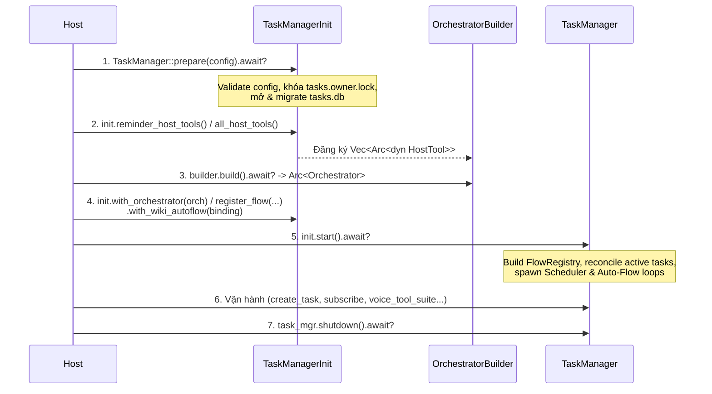

# Tài Liệu API Đầy Đủ — `orchestrator_flow_rs` (`orchestrator-flow`)

Tài liệu tham chiếu toàn diện cho crate **`orchestrator_flow_rs`** (package Cargo: `orchestrator-flow` `v0.1.0`) — thư viện Rust quản lý **Task** chạy nền, hàng đợi **Followup**, bộ lập lịch **Schedule / Reminder** (One-shot Timer & Cron), bộ công cụ **Dual-Mode Tools** (Voice Agent Raw JSON & `HostTool`), và cầu nối **Wiki Auto-Flow** trên một hoặc nhiều **Flow** (`Orchestrator`).

- **Package Cargo**: `orchestrator-flow`
- **Tên crate khi import trong Rust**: `orchestrator_flow_rs`
- **Rust Edition / MSRV**: Edition 2021, Rust $\ge 1.89$
- **Async Runtime**: Tokio (`rt`, `sync`, `time`, `fs`)
- **Lưu trữ**: SQLite độc lập (`tasks.db` ở chế độ WAL) kèm khóa tiến trình độc quyền (`tasks.owner.lock`) theo [ADR-0001](adr/0001-separate-task-sqlite-store.md)
- **Từ điển miền**: Xem [CONTEXT.md](../CONTEXT.md) và [GLOSSARY.md](../GLOSSARY.md)

---

## Mục Lục

1. [Tổng Quan Kiến Trúc & Danh Mục Public Exports](#1-tổng-quan-kiến-trúc--danh-mục-public-exports)
2. [Hằng Số & Cô Lập Phạm Vi (`TaskScope`)](#2-hằng-số--cô-lập-phạm-vi-taskscope)
3. [Cấu Hình & Bố Cục Thư Mục (`WorkspaceLayout`, `TaskConfig`, `TaskRuntimeConfig`, `TargetAgent`)](#3-cấu-hình--bố-cục-thư-mục-workspacelayout-taskconfig-taskruntimeconfig-targetagent)
4. [Khởi Tạo 2 Pha & Vòng Đời (`TaskManager::prepare`, `TaskManagerInit`, `TaskManager::shutdown`)](#4-khởi-tạo-2-pha--vòng-đời-taskmanagerprepare-taskmanagerinit-taskmanagershutdown)
5. [Điều Phối Task & Hàng Đợi Followup (`create_task`, `send_followup`, `cancel_task`, `delete_task`)](#5-điều-phối-task--hàng-đợi-followup-create_task-send_followup-cancel_task-delete_task)
6. [Truy Vấn Trạng Thái & Quan Sát Thời Gian Thực (`get_task`, `get_task_detail`, `list_tasks`, `subscribe`)](#6-truy-vấn-trạng-thái--quan-sát-thời-gian-thực-get_task-get_task_detail-list_tasks-subscribe)
7. [Quản Lý Lịch Hẹn & Lời Nhắc (`Schedule` & `Reminder` API)](#7-quản-lý-lịch-hẹn--lời-nhắc-schedule--reminder-api)
8. [Bộ Công Cụ Dual-Mode (`TaskToolSuite` & `TaskToolSpec`)](#8-bộ-công-cụ-dual-mode-tasktoolsuite--tasktoolspec)
9. [Tích Hợp Wiki Auto-Flow (`WikiAutoFlowBinding`)](#9-tích-hợp-wiki-auto-flow-wikiautoflowbinding)
10. [Xử Lý Lỗi (`TaskResult`, `TaskError`, `ErrorCode`)](#10-xử-lý-lỗi-taskresult-taskerror-errorcode)
11. [Ví Dụ Tích Hợp End-to-End](#11-ví-dụ-tích-hợp-end-to-end)

---

## 1. Tổng Quan Kiến Trúc & Danh Mục Public Exports

```mermaid
flowchart TB
    subgraph Host["Host Application (Voice Agent / HTTP / CLI)"]
        VA["Voice Agent (Raw JSON)"]
        UI["Task View UI (SSE / WebSocket / REST)"]
    end

    subgraph TaskCrate["orchestrator_flow_rs (Deep Module)"]
        TM["TaskManager"]
        TS["TaskToolSuite"]
        SC["Scheduler Worker (Cron & Timer)"]
        AF["Auto-Flow Worker"]
        WT["Per-Task Watchers"]
        EB["TaskEventBus (broadcast)"]
        DB[("tasks.db + tasks.owner.lock")]
    end

    subgraph Flows["Registered Orchestrator Flows"]
        O1["Orchestrator (daily / default)"]
        O2["Orchestrator (wiki)"]
        WE["llm_wiki::WikiEngine"]
    end

    VA -->|execute_raw| TS
    TS --> TM
    UI -->|list_tasks / get_task_detail / subscribe| TM
    EB -->|TaskSubscription| UI
    TM --> DB
    SC --> DB
    SC -->|NotifyOnly -> ReminderDue| EB
    SC -->|SpawnTask| TM
    AF -->|build_next_autoflow_prompt| WE
    AF -->|CreateTaskRequest (Autoflow)| TM
    TM -->|create_session / submit / cancel| O1
    TM -->|create_session / submit / cancel| O2
    WT -->|subscribe / result| O1
    WT -->|subscribe / result| O2
    WT -->|TaskProgress / TaskExecutionStream / TaskTerminal| EB
```

Toàn bộ kiểu dữ liệu và hàm public được re-export trực tiếp tại gốc crate [`src/lib.rs`](../src/lib.rs):

```rust
use orchestrator_flow_rs::{
    // Hằng số mặc định
    DEFAULT_FLOW_ID, DEFAULT_OWNER_ID, DEFAULT_WORKSPACE_ID,

    // Cấu hình & Bố cục thư mục
    TargetAgent, TaskConfig, TaskRuntimeConfig, WorkspaceLayout,

    // Lỗi & Kết quả
    ErrorCode, TaskError, TaskResult,

    // Quản lý vòng đời & Điều phối trung tâm
    TaskManager, TaskManagerInit, WikiAutoFlowBinding,

    // Bộ công cụ cho Voice Agent, HostTool & WorkspaceToolKit
    add_to_sources_host_tool, build_sample_technical_pdf, convert_document_with_anydoc,
    fetch_playlist, fetch_transcript, pdf_host_tools, report_host_tools, wiki_host_tools,
    wiki_readonly_host_tools, youtube_host_tools, AddToSourcesTool, AnydocInspectPdfTool,
    AnydocSaveToSourcesTool, ConvertedPdfDoc, MarkdownCreateTool, MarkdownReadTool,
    PlaylistVideoEntry, SharedPdfState, TaskToolSpec, TaskToolSuite, WikiEngineBridgeTool,
    WorkspaceToolKit, YoutubeCollectorEnv, YtFetchTranscriptTool, YtListPlaylistTool, WorkspaceToolKit,
    add_to_sources_host_tool, build_sample_technical_pdf, convert_document_with_anydoc,
    fetch_playlist, fetch_transcript, pdf_host_tools, report_host_tools, wiki_host_tools,
    wiki_readonly_host_tools, youtube_host_tools,
    AddToSourcesTool, AnydocInspectPdfTool, AnydocSaveToSourcesTool, ConvertedPdfDoc,
    MarkdownCreateTool, MarkdownReadTool, PlaylistVideoEntry, SharedPdfState,
    WikiEngineBridgeTool, YoutubeCollectorEnv, YtFetchTranscriptTool, YtListPlaylistTool,

    // Kiểu dữ liệu miền (Scope, Task, Followup, Agent Execution, Schedule/Reminder, Event)
    AgentCatalogEntry, CreateScheduleRequest, CreateTaskRequest,
    FollowupStatus, FollowupView, Priority,
    ScheduleActionKind, ScheduleFilter, ScheduleKind, ScheduleSessionMode,
    ScheduleStatus, ScheduleView,
    TaskAgentMessageView, TaskAgentRunView, TaskAgentSessionView,
    TaskDetailView, TaskEvent, TaskExecutionSummary, TaskFeedItem, TaskFilter,
    TaskMessageToolCallView, TaskPage, TaskScope, TaskSource, TaskStatus,
    TaskSubscription, TaskToolInvocationView, TaskView, WikiDeleteOutcome,
};
```

---

## 2. Hằng Số & Cô Lập Phạm Vi (`TaskScope`)

Mọi bản ghi Task và Schedule trong `tasks.db` đều được cô lập theo cặp định danh `(owner_id, workspace_id)`.

### 2.1. Hằng số mặc định

| Hằng số | Kiểu | Giá trị | Ý nghĩa |
| --- | --- | --- | --- |
| `DEFAULT_FLOW_ID` | `&'static str` | `"default"` | Định danh Flow mặc định khi gắn 1 `Orchestrator` hợp nhất qua `with_orchestrator()` hoặc `with_default_agent()`. |
| `DEFAULT_OWNER_ID` | `&'static str` | `"personal"` | `owner_id` mặc định của `TaskScope::default()`. |
| `DEFAULT_WORKSPACE_ID` | `&'static str` | `"homelab"` | `workspace_id` mặc định của `TaskScope::default()`. |

### 2.2. Struct `TaskScope`

Định nghĩa tại [`src/types/scope.rs`](../src/types/scope.rs):

```rust
#[derive(Debug, Clone, PartialEq, Eq, Hash, Serialize, Deserialize)]
pub struct TaskScope {
    pub owner_id: String,
    pub workspace_id: String,
}
```

| Phương thức | Chữ ký | Mô tả |
| --- | --- | --- |
| `Default::default` | `fn default() -> Self` | Trả về `TaskScope { owner_id: "personal", workspace_id: "homelab" }`. |
| `TaskScope::new` | `pub fn new(owner_id: impl Into<String>, workspace_id: impl Into<String>) -> Self` | Khởi tạo `TaskScope` tùy chỉnh. `owner_id` và `workspace_id` không được rỗng sau khi `trim()`. |
| `to_caller_context` | `pub fn to_caller_context(&self) -> CallerContext` | Chuyển đổi sang `orchestrator_agent_rs::CallerContext` để gọi các API của `Orchestrator`. |
| `from_tool_scope` | `pub fn from_tool_scope(scope: &ToolScope) -> Self` | Trích xuất `TaskScope` từ `orchestrator_agent_rs::ToolScope` bên trong `HostTool::execute`. |

> **Quy ước API `*_scoped`:** Mọi thao tác trên `TaskManager` và `TaskToolSuite` đều có 2 biến thể:
> - Hàm ngắn gọn (VD: `create_task`, `list_tasks`, `subscribe`, `execute_raw`) sử dụng `TaskConfig::default_scope`.
> - Hàm hậu tố `_scoped` (VD: `create_task_scoped`, `list_tasks_scoped`, `subscribe_scoped`, `execute_raw_scoped`) nhận `&TaskScope` hoặc `TaskScope` tường minh cho môi trường đa người dùng / đa workspace.

---

## 3. Cấu Hình & Bố Cục Thư Mục (`WorkspaceLayout`, `TaskConfig`, `TaskRuntimeConfig`, `TargetAgent`)

Định nghĩa tại [`src/config.rs`](../src/config.rs).

### 3.1. Struct `WorkspaceLayout`

Chuẩn hóa toàn bộ đường dẫn lưu trữ từ một thư mục gốc duy nhất (`workspace_root`) trên Homelab Server.

```rust
#[derive(Debug, Clone, PartialEq, Eq)]
pub struct WorkspaceLayout { /* private fields */ }
```

```text
<workspace_root>/
├── vault/                  # layout.wiki_vault_dir() -> WikiEngine Obsidian Vault & .wiki/index.sqlite
├── stores/
│   ├── tasks/              # layout.tasks_store_dir() -> tasks.db & tasks.owner.lock
│   ├── orchestrator/       # layout.orchestrator_store_dir() -> orchestrator.db (mô hình 1 Orchestrator hợp nhất)
│   ├── daily_orch/         # layout.daily_orch_store_dir() -> khi tách riêng Flow daily
│   └── wiki_orch/          # layout.wiki_orch_store_dir() -> khi tách riêng Flow wiki
├── prompts/                # layout.prompts_dir() -> các file system prompt (.md)
├── skills/                 # layout.skills_dir() -> skills/<id>/SKILL.md
└── reports/                # layout.reports_dir() -> báo cáo Markdown xuất rời (Standalone Reports)
```

| Phương thức | Chữ ký | Giá trị trả về / Hành vi |
| --- | --- | --- |
| `new` | `pub fn new(root_dir: impl Into<PathBuf>) -> Self` | Tạo `WorkspaceLayout` từ đường dẫn gốc. |
| `root_dir` | `pub fn root_dir(&self) -> &Path` | Trả về đường dẫn `<root>`. |
| `wiki_vault_dir` | `pub fn wiki_vault_dir(&self) -> PathBuf` | `<root>/vault` |
| `tasks_store_dir` | `pub fn tasks_store_dir(&self) -> PathBuf` | `<root>/stores/tasks` |
| `orchestrator_store_dir` | `pub fn orchestrator_store_dir(&self) -> PathBuf` | `<root>/stores/orchestrator` |
| `daily_orch_store_dir` | `pub fn daily_orch_store_dir(&self) -> PathBuf` | `<root>/stores/daily_orch` |
| `wiki_orch_store_dir` | `pub fn wiki_orch_store_dir(&self) -> PathBuf` | `<root>/stores/wiki_orch` |
| `flow_store_dir` | `pub fn flow_store_dir(&self, name: &str) -> PathBuf` | `<root>/stores/<name>` |
| `prompts_dir` | `pub fn prompts_dir(&self) -> PathBuf` | `<root>/prompts` |
| `skills_dir` | `pub fn skills_dir(&self) -> PathBuf` | `<root>/skills` |
| `reports_dir` | `pub fn reports_dir(&self) -> PathBuf` | `<root>/reports` |
| `ensure_dirs` | `pub fn ensure_dirs(&self) -> std::io::Result<()>` | Tạo sẵn `vault`, `stores/tasks`, `stores/orchestrator`, `prompts`, `skills`, `reports` trên đĩa nếu chưa tồn tại. |

### 3.2. Struct `TargetAgent`

Định danh một Root/Primary Agent mục tiêu trên một Flow cụ thể.

```rust
#[derive(Debug, Clone, PartialEq, Eq, Serialize, Deserialize)]
pub struct TargetAgent {
    pub flow_id: String,
    pub agent_id: String,
}
```

| Phương thức | Chữ ký | Mô tả |
| --- | --- | --- |
| `new` | `pub fn new(flow_id: impl Into<String>, agent_id: impl Into<String>) -> Self` | Tạo `TargetAgent`. |
| `canonical_key` | `pub fn canonical_key(&self) -> String` | Trả về chuỗi `"<flow_id>/<agent_id>"` (VD: `"daily/daily_root"` hoặc `"default/daily_root"`). |

### 3.3. Struct `TaskRuntimeConfig`

Tham số vận hành cho các background worker của `TaskManager`.

```rust
#[derive(Debug, Clone)]
pub struct TaskRuntimeConfig {
    pub scheduler_tick: Duration,
    pub autoflow_poll_interval: Duration,
    pub event_capacity: usize,
    pub page_size: u32,
    pub output_preview_chars: usize,
    pub shutdown_grace: Duration,
}
```

| Trường | Kiểu | Mặc định | Ràng buộc hợp lệ (`validate`) | Ý nghĩa |
| --- | --- | --- | --- | --- |
| `scheduler_tick` | `Duration` | `15s` | `> 0` | Chu kỳ ngủ tối đa của vòng lặp Scheduler khi không có lịch hẹn nào gần hơn. |
| `autoflow_poll_interval` | `Duration` | `60s` | `> 0` | Chu kỳ quét dự phòng cho Auto-Flow (ngoài tín hiệu `autoflow_notify` tức thì). |
| `event_capacity` | `usize` | `1024` | `> 0` | Sức chứa kênh `tokio::sync::broadcast` cho `TaskEvent`. |
| `page_size` | `u32` | `50` | `1..=500` | Số bản ghi tối đa trên mỗi trang khi gọi `list_tasks` / `list_schedules`. |
| `output_preview_chars` | `usize` | `2000` | `> 0` | Số ký tự Unicode tối đa lưu vào `TaskView::output_preview` khi Task hoàn tất (vượt quá sẽ cắt và nối `'…'`). |
| `shutdown_grace` | `Duration` | `15s` | `> 0` | Thời gian chờ tối đa để các background worker và task watcher dừng hẳn khi gọi `TaskManager::shutdown()`. |

### 3.4. Struct `TaskConfig`

Cấu hình khởi tạo `TaskManager` (validate cục bộ khi gọi `TaskManager::prepare`).

```rust
#[derive(Debug, Clone)]
pub struct TaskConfig {
    pub store_dir: PathBuf,
    pub wiki_vault_dir: Option<PathBuf>,
    pub default_scope: TaskScope,
    pub default_timezone: String,
    pub default_target: Option<TargetAgent>,
    pub runtime: TaskRuntimeConfig,
}
```

| Hàm khởi tạo / Builder | Chữ ký | Mô tả |
| --- | --- | --- |
| `new` | `pub fn new(store_dir: impl Into<PathBuf>) -> Self` | Tạo cấu hình với `store_dir`, `default_timezone = "Asia/Ho_Chi_Minh"`, `default_scope = TaskScope::default()`, `wiki_vault_dir = None`, `default_target = None`. |
| `from_layout` | `pub fn from_layout(layout: &WorkspaceLayout) -> Self` | Tự động đặt `store_dir = layout.tasks_store_dir()` và `wiki_vault_dir = Some(layout.wiki_vault_dir())`. |
| `from_workspace_root` | `pub fn from_workspace_root(root_dir: impl Into<PathBuf>) -> Self` | Tạo `WorkspaceLayout::new(root_dir)` rồi gọi `from_layout`. |
| `with_wiki_vault_dir` | `pub fn with_wiki_vault_dir(self, vault_dir: impl Into<PathBuf>) -> Self` | Đặt đường dẫn thư mục gốc của Wiki Vault. |
| `with_default_scope` | `pub fn with_default_scope(self, scope: TaskScope) -> Self` | Đặt `TaskScope` mặc định. |
| `with_default_timezone` | `pub fn with_default_timezone(self, tz: impl Into<String>) -> Self` | Đặt múi giờ IANA mặc định (VD: `"Asia/Ho_Chi_Minh"`, `"UTC"`, `"America/New_York"`). Phải parse được bằng `chrono_tz::Tz`. |
| `with_default_target` | `pub fn with_default_target(self, flow_id: impl Into<String>, agent_id: impl Into<String>) -> Self` | Đặt cặp `(flow_id, agent_id)` mặc định khi caller không chỉ định `target_agent`. |
| `with_default_agent` | `pub fn with_default_agent(self, agent_id: impl Into<String>) -> Self` | Đặt `default_target = Some(TargetAgent::new("default", agent_id))` cho mô hình 1 `Orchestrator` hợp nhất. |
| `with_runtime` | `pub fn with_runtime(self, runtime: TaskRuntimeConfig) -> Self` | Ghi đè `TaskRuntimeConfig`. |

---

## 4. Khởi Tạo 2 Pha & Vòng Đời (`TaskManager::prepare`, `TaskManagerInit`, `TaskManager::shutdown`)

Theo [ADR-0002](adr/0002-two-phase-initialization-for-host-tools.md), quá trình khởi tạo được tách thành **2 pha** để giải quyết phụ thuộc vòng giữa việc đăng ký `HostTool` vào `OrchestratorBuilder` và việc gắn `Arc<Orchestrator>` đã build vào `TaskManager`.



### 4.1. Pha 1: `TaskManager::prepare`

```rust
impl TaskManager {
    pub async fn prepare(config: TaskConfig) -> TaskResult<TaskManagerInit>;
}
```

- **Hành vi**:
  1. Kiểm tra tính hợp lệ của `TaskConfig` (`store_dir` không rỗng, `default_scope` hợp lệ, `default_timezone` là tên múi giờ IANA hợp lệ, `runtime` hợp lệ). Sai cấu hình trả `ErrorCode::InvalidConfig`.
  2. Tạo thư mục `config.store_dir` nếu chưa có.
  3. Lấy khóa độc quyền không chặn (`try_lock`) trên `<store_dir>/tasks.owner.lock`. Nếu tiến trình hoặc instance `TaskManager` khác đang giữ khóa, trả ngay `ErrorCode::StoreAlreadyOwned`.
  4. Mở SQLite pool tới `<store_dir>/tasks.db` (chế độ `WAL`, `foreign_keys = ON`, `busy_timeout = 5s`, `max_connections = 5`) và chạy toàn bộ SQL migrations trong `migrations/`.

### 4.2. Struct `TaskManagerInit` (Giai đoạn cấu hình trung gian)

Định nghĩa tại [`src/manager/mod.rs`](../src/manager/mod.rs) và [`src/manager/prepare.rs`](../src/manager/prepare.rs):

| Phương thức | Chữ ký | Mô tả |
| --- | --- | --- |
| `task_host_tools` | `pub fn task_host_tools(&self) -> Vec<Arc<dyn HostTool>>` | Xuất 6 `HostTool` nhóm `task_*` (`task_create`, `task_followup`, `task_list`, `task_detail`, `task_cancel`, `task_delete`) trước khi gọi `OrchestratorBuilder::build()`. |
| `reminder_host_tools` | `pub fn reminder_host_tools(&self) -> Vec<Arc<dyn HostTool>>` | Xuất 4 `HostTool` (`reminder_create`, `reminder_list`, `reminder_complete`, `reminder_delete`) để đăng ký vào `OrchestratorBuilder` (thường cho subagent `reminder_planner`). |
| `all_host_tools` | `pub fn all_host_tools(&self) -> Vec<Arc<dyn HostTool>>` | Xuất toàn bộ 10 `HostTool` (`task_create`, `task_followup`, `task_list`, `task_detail`, `task_cancel`, `task_delete`, `reminder_create`, `reminder_list`, `reminder_complete`, `reminder_delete`). |
| `with_orchestrator` | `pub fn with_orchestrator(self, orchestrator: Arc<Orchestrator>) -> Self` | Gắn một instance `Orchestrator` hợp nhất dưới tên Flow mặc định `DEFAULT_FLOW_ID` (`"default"`). |
| `register_flow` | `pub fn register_flow(self, flow_id: impl Into<String>, orchestrator: Arc<Orchestrator>) -> Self` | Gắn một instance `Orchestrator` với định danh `flow_id` cụ thể (VD: `"daily"`, `"wiki"`). Có thể gọi nhiều lần cho nhiều Flow. |
| `with_wiki_autoflow` | `pub fn with_wiki_autoflow(self, binding: WikiAutoFlowBinding) -> Self` | Gắn cầu nối `WikiAutoFlowBinding` để tự động chuyển tín hiệu `autoflow_notify` hoặc nguồn mới trong `sources/` thành Task trên Flow biên dịch Wiki (đồng thời tự động đăng ký `binding.engine` vào `TaskManager`). |
| `with_wiki_engine` | `pub fn with_wiki_engine(self, engine: Arc<WikiEngine>) -> Self` | Gắn trực tiếp `Arc<WikiEngine>` vào `TaskManager` để dùng cho các thao tác quản trị vault (`delete_wiki_file`, `delete_source_file`, `wiki_engine()`) ngay cả khi không bật Wiki Auto-Flow. |
| `start` | `pub async fn start(self) -> TaskResult<Arc<TaskManager>>` | Chuyển sang Pha 2: kiểm tra Flow/Agent, đồng bộ (reconcile) các Task đang dở dang và khởi chạy các background worker. |

> **Lưu ý khi gọi `HostTool` trước `start()`:** Nếu một `HostTool` được thực thi trước khi `TaskManagerInit::start()` hoàn tất, các thao tác cần `FlowRegistry` (như `task_create`) sẽ trả lỗi `ErrorCode::NotReady`. Ở Pha 1 (`prepare`), `HostTool::descriptor()` dùng fallback schema hợp lệ để vượt qua bước kiểm tra của `OrchestratorBuilder::build()`; sau khi `start()`, `descriptor()` tự động trả về schema có đính kèm danh mục `target_agent` động.

### 4.3. Pha 2: `TaskManagerInit::start` & Cơ chế Startup Reconciliation

Khi gọi `init.start().await`:
1. **Xây dựng `FlowRegistry`**:
   - Phải có ít nhất 1 Flow được đăng ký (nếu không trả `ErrorCode::InvalidConfig`).
   - Quét toàn bộ agent trong các `Orchestrator` đã đăng ký; mọi agent có `mode != AgentMode::Subagent` (`Primary` hoặc `All`) được đưa vào danh mục `AgentCatalogEntry`. Nếu không có agent nào có khả năng làm root, trả `ErrorCode::InvalidConfig`.
   - Nếu `TaskConfig::default_target` được cấu hình, kiểm tra agent đó phải tồn tại trong danh mục root-capable agents; nếu `None`, tự động chọn root agent đầu tiên trong danh mục làm `default_target`.
   - Nếu `with_wiki_autoflow` được gắn, kiểm tra `flow_id/agent_id` của `WikiAutoFlowBinding` phải tồn tại trong danh mục.
2. **Reconcile các Task đang chạy dở (`queued` / `running`) từ lần chạy trước**:
   - Với mỗi Task chưa ở trạng thái kết thúc trong `tasks.db`:
     - Truy vấn `orch.result(&caller, &task.session_id, &turn_id).await`:
       - Nếu turn trong `Orchestrator` đã kết thúc (`Completed`, `Failed`, `Cancelled`, `TimedOut`, `Interrupted`): nếu `Completed` và còn `Followup` đang chờ (`Pending`), tự động submit followup kế tiếp; ngược lại cập nhật Task sang trạng thái kết thúc tương ứng.
       - Nếu turn vẫn đang `Running` (hoặc vừa submit followup): gắn lại `Watcher` (`ensure_task_watcher`) để tiếp tục theo dõi.
       - Nếu Flow hoặc session không còn tồn tại: đánh dấu Task là `TaskStatus::Interrupted` với `error_code = Some("RECOVERY_FAILED")`.
3. **Khởi chạy Background Workers**:
   - Spawn vòng lặp `Scheduler` (`spawn_scheduler_loop`).
   - Nếu có `WikiAutoFlowBinding`, spawn vòng lặp `AutoFlow` (`spawn_autoflow_loop`).

### 4.4. Đóng Hệ Thống: `TaskManager::shutdown`

```rust
impl TaskManager {
    pub async fn shutdown(&self) -> TaskResult<()>;
}
```

- Kích hoạt `CancellationToken` để thông báo dừng cho `Scheduler`, `AutoFlow`, mọi `TaskWatcher` đang chạy và mọi `TaskSubscription` đang mở.
- Chờ `join` tất cả worker và watcher trong thời gian tối đa `config.runtime.shutdown_grace` (mặc định `15s`).
- Đóng SQLite connection pool (`tasks.db`) và nhả khóa file `tasks.owner.lock`.
- Sau khi `shutdown()`, các lời gọi API tới `TaskManager` sẽ trả về `ErrorCode::ShuttingDown`.

---

## 5. Điều Phối Task & Hàng Đợi Followup (`create_task`, `send_followup`, `cancel_task`, `delete_task`)

Định nghĩa tại [`src/manager/dispatch.rs`](../src/manager/dispatch.rs) và [`src/types/task.rs`](../src/types/task.rs).

### 5.1. Bảng phương thức điều phối trên `TaskManager`

| Phương thức | Chữ ký | Mô tả |
| --- | --- | --- |
| `create_task` | `pub async fn create_task(&self, req: CreateTaskRequest) -> TaskResult<TaskView>` | Tạo và chạy ngay một Task trên `default_scope`. |
| `create_task_scoped` | `pub async fn create_task_scoped(&self, scope: &TaskScope, req: CreateTaskRequest) -> TaskResult<TaskView>` | Tạo và chạy ngay một Task trên `scope` chỉ định. |
| `send_followup` | `pub async fn send_followup(&self, task_id: &str, prompt: impl Into<String>, source: TaskSource) -> TaskResult<FollowupView>` | Gửi chỉ dẫn bổ sung (Followup) vào Task thuộc `default_scope`. |
| `send_followup_scoped` | `pub async fn send_followup_scoped(&self, scope: &TaskScope, task_id: &str, prompt: impl Into<String>, source: TaskSource) -> TaskResult<FollowupView>` | Gửi Followup vào Task thuộc `scope` chỉ định. |
| `cancel_task` | `pub async fn cancel_task(&self, task_id: &str) -> TaskResult<TaskView>` | Hủy Task đang chạy/xếp hàng trong `default_scope` và hủy mọi Followup đang chờ của Task đó. |
| `cancel_task_scoped` | `pub async fn cancel_task_scoped(&self, scope: &TaskScope, task_id: &str) -> TaskResult<TaskView>` | Hủy Task trong `scope` chỉ định. |
| `delete_task` | `pub async fn delete_task(&self, task_id: &str) -> TaskResult<()>` | Xóa vĩnh viễn Task trong `default_scope`: tự động cancel và dừng watcher nếu Task chưa kết thúc, xóa dây chuyền `ON DELETE CASCADE` các `task_followups` trong `tasks.db`, xóa luôn `Orchestrator` session tương ứng (nếu không còn Task nào khác dùng chung `session_id`), và phát sự kiện `TaskEvent::TaskDeleted`. |
| `delete_task_scoped` | `pub async fn delete_task_scoped(&self, scope: &TaskScope, task_id: &str) -> TaskResult<()>` | Xóa vĩnh viễn Task + `Orchestrator` session trong `scope` chỉ định và phát `TaskEvent::TaskDeleted`. |
| `delete_wiki_file` | `pub async fn delete_wiki_file(&self, rel_path: &str) -> TaskResult<WikiDeleteOutcome>` | Xóa một trang Markdown trong `wiki/` (VD: `"concepts/rust.md"` hoặc `"wiki/concepts/rust.md"`), xóa vector/FTS5 chunks trong `.wiki/index.sqlite` và đồng bộ lại `wiki/index.md`. |
| `delete_source_file` | `pub async fn delete_source_file(&self, rel_path: &str, delete_wiki_mirror: bool) -> TaskResult<WikiDeleteOutcome>` | Xóa một tài liệu nguồn trong `sources/` (VD: `"guide.md"` hoặc `"sources/guide.md"`), xóa chunks chỉ mục; nếu `delete_wiki_mirror = true` thì xóa luôn trang mirror `wiki/sources/<slug>.md` và đồng bộ lại `wiki/index.md`. |

### 5.2. Cơ chế Phân giải `target_agent`

Khi `CreateTaskRequest::target_agent` được truyền vào:
1. **`None` hoặc chuỗi rỗng**: Sử dụng `default_target` (đã cấu hình hoặc Primary agent đầu tiên khi `start()`).
2. **Định dạng `"<flow_id>/<agent_id>"`** (VD: `"daily/daily_root"` hoặc `"default/wiki_root"`): Khớp chính xác cả `flow_id` và `agent_id` trong danh mục Root/Primary Agent.
3. **Định dạng `"<agent_id>"`** (VD: `"daily_root"` hoặc `"wiki_root"`): Tìm Root/Primary Agent đầu tiên có `agent_id` khớp trong danh mục các Flow đã đăng ký.
4. Nếu không khớp agent nào, trả lỗi `ErrorCode::InvalidInput` kèm danh sách các agent hợp lệ.

### 5.3. Cơ chế Session & Hàng đợi Followup

- **Khi `create_task`**:
  - Nếu `existing_session_id` là `None`, `TaskManager` gọi `orch.create_session(&caller, &target.agent_id).await?` để tạo Root session mới.
  - Nếu `existing_session_id` là `Some(sid)`, tái sử dụng session đó:
    - Nếu session rảnh: `orch.submit` thành công ngay $\rightarrow$ Task được lưu với trạng thái `TaskStatus::Running`, phát sự kiện `TaskEvent::TaskCreated`, và mở `Watcher`.
    - Nếu session đang bận (`OrchestratorError` có mã `SESSION_BUSY`): Task vẫn được tạo thành công với trạng thái `TaskStatus::Queued` (`latest_turn_id = None`), đồng thời prompt được xếp vào bảng `task_followups` ở trạng thái `FollowupStatus::Pending` để Watcher tự động submit ngay khi turn hiện tại hoàn tất.
- **Khi `send_followup`**:
  - Lưu bản ghi Followup vào `task_followups` (`Pending`).
  - Nếu Task hiện **không** ở trạng thái `Running` và `orch.submit` thành công ngay lập tức: Followup chuyển sang `FollowupStatus::Submitted` (kèm `submitted_turn_id` và `submitted_at`), Task chuyển lại sang `TaskStatus::Running`, và Watcher được kích hoạt lại.
  - Nếu Task đang `Running` (hoặc session đang bận): giữ Followup ở trạng thái `FollowupStatus::Pending`, phát sự kiện `TaskEvent::FollowupQueued`, và khi turn hiện tại của Task hoàn tất (`RunStatus::Completed`), Watcher sẽ tự động lấy Followup `Pending` tiếp theo theo thứ tự FIFO (`created_at ASC`) để submit vào cùng `session_id`.

### 5.4. Các kiểu dữ liệu Task & Followup

#### `CreateTaskRequest`

```rust
#[derive(Debug, Clone, Serialize, Deserialize)]
pub struct CreateTaskRequest {
    pub title: String,
    pub prompt: String,
    pub target_agent: Option<String>,
    pub source: TaskSource,
    pub schedule_id: Option<String>,
    pub existing_session_id: Option<String>,
    pub related_wiki_links: Vec<String>,
}
```

| Phương thức Builder | Chữ ký | Mô tả |
| --- | --- | --- |
| `new` | `pub fn new(title: impl Into<String>, prompt: impl Into<String>) -> Self` | Khởi tạo request với `source = TaskSource::Api`, các trường tùy chọn là `None` / `Vec::new()`. `title` và `prompt` không được rỗng. |
| `with_target` | `pub fn with_target(self, target_agent: impl Into<String>) -> Self` | Đặt `target_agent` (VD: `"daily_root"` hoặc `"daily/daily_root"`). |
| `with_source` | `pub fn with_source(self, source: TaskSource) -> Self` | Đặt nguồn kích hoạt (`Voice`, `Api`, `Chat`, `Schedule`, `Autoflow`). |
| `with_wiki_links` | `pub fn with_wiki_links(self, links: Vec<String>) -> Self` | Đính kèm danh sách liên kết `[[WikiLinks]]` liên quan. |

#### `TaskStatus`

```rust
#[derive(Debug, Clone, Copy, PartialEq, Eq, Serialize, Deserialize)]
#[serde(rename_all = "snake_case")]
pub enum TaskStatus {
    Queued,
    Running,
    Completed,
    Failed,
    Cancelled,
    Interrupted,
}
```

- Phương thức:
  - `pub fn as_str(self) -> &'static str`: trả về `"queued"`, `"running"`, `"completed"`, `"failed"`, `"cancelled"`, `"interrupted"`.
  - `pub fn from_db(s: &str) -> Self`: đọc từ chuỗi lưu trong DB.
  - `pub fn from_run_status(status: RunStatus) -> Self`: ánh xạ từ `orchestrator_agent_rs::RunStatus` (`TimedOut` $\rightarrow$ `Failed`).
  - `pub fn is_terminal(self) -> bool`: trả về `true` nếu thuộc `Completed | Failed | Cancelled | Interrupted`.

#### `TaskSource`

```rust
#[derive(Debug, Clone, Copy, PartialEq, Eq, Serialize, Deserialize)]
#[serde(rename_all = "snake_case")]
pub enum TaskSource {
    Voice,
    Api,
    Chat,
    Schedule,
    Autoflow,
}
```

- Phương thức: `pub fn as_str(self) -> &'static str`, `pub fn from_db(s: &str) -> Self`.

#### `TaskView`

Bản ghi trạng thái của một Task (trả về từ `create_task`, `get_task`, `list_tasks`, `cancel_task` và trong `TaskEvent`):

```rust
#[derive(Debug, Clone, PartialEq, Eq, Serialize, Deserialize)]
pub struct TaskView {
    pub id: String,
    pub owner_id: String,
    pub workspace_id: String,
    pub title: String,
    pub prompt: String,
    pub flow_id: String,
    pub agent_id: String,
    pub source: TaskSource,
    pub schedule_id: Option<String>,
    pub session_id: String,
    pub latest_turn_id: Option<String>,
    pub status: TaskStatus,
    pub active_subagent: Option<String>,
    pub active_tool: Option<String>,
    pub progress_summary: Option<String>,
    pub output_preview: Option<String>,
    pub related_wiki_links: Vec<String>,
    pub error_code: Option<String>,
    pub error_message: Option<String>,
    pub created_at: i64,
    pub started_at: Option<i64>,
    pub updated_at: i64,
    pub finished_at: Option<i64>,
}
```

*(Tất cả các trường thời gian `*_at` đều là Unix epoch milliseconds `i64`).*

#### `FollowupStatus` & `FollowupView`

```rust
#[derive(Debug, Clone, Copy, PartialEq, Eq, Serialize, Deserialize)]
#[serde(rename_all = "snake_case")]
pub enum FollowupStatus {
    Pending,
    Submitted,
    Cancelled,
}

#[derive(Debug, Clone, PartialEq, Eq, Serialize, Deserialize)]
pub struct FollowupView {
    pub id: String,
    pub task_id: String,
    pub prompt: String,
    pub source: TaskSource,
    pub status: FollowupStatus,
    pub submitted_turn_id: Option<String>,
    pub created_at: i64,
    pub submitted_at: Option<i64>,
}
```

### 5.5. Xóa dữ liệu Task, Wiki và Source (`WikiDeleteOutcome`)

Bên cạnh `delete_task` / `delete_task_scoped` (xóa đồng bộ cả bản ghi trong `tasks.db`, dọn sạch session/messages/runs trong `orchestrator.db` và phát `TaskEvent::TaskDeleted`), `TaskManager` cung cấp API quản trị để xóa trực tiếp các trang Wiki (`wiki/`) và tài liệu nguồn (`sources/`) thông qua `WikiEngine` đã gắn (hoặc tự động mở từ `TaskConfig::wiki_vault_dir`):

```rust
#[derive(Debug, Clone, PartialEq, Eq, Serialize, Deserialize)]
pub struct WikiDeleteOutcome {
    /// Đường dẫn tương đối đã chuẩn hóa trong vault (VD: "wiki/concepts/rust.md" hoặc "sources/guide.md").
    pub rel_path: String,
    /// `true` nếu file hoặc bản ghi index tồn tại và đã được xóa.
    pub deleted: bool,
    /// Số lượng chunks tìm kiếm (FTS5 / vector) đã xóa khỏi `.wiki/index.sqlite`.
    pub removed_chunks: usize,
    /// Đường dẫn trang mirror `wiki/sources/<slug>.md` đã được xóa kèm (nếu gọi `delete_source_file(..., true)`).
    pub mirror_wiki_rel_path: Option<String>,
    /// `true` nếu `wiki/index.md` đã được đồng bộ / dựng lại sau khi xóa.
    pub index_synced: bool,
}
```

> Ngoài ra, trên crate `llm_wiki` (`WikiEngine`), bạn cũng có thể gọi trực tiếp:
> - `wiki_engine.delete_wiki_file("concepts/rust.md")`
> - `wiki_engine.delete_source_file("guide.md", true)`
> - `wiki_engine.delete_file(CollectionScope::Wiki | CollectionScope::Sources, rel_path, DeleteOptions { delete_wiki_mirror })`

---

## 6. Truy Vấn Trạng Thái & Quan Sát Thời Gian Thực (`get_task`, `get_task_detail`, `list_tasks`, `subscribe`)

Định nghĩa tại [`src/manager/query_api.rs`](../src/manager/query_api.rs) và [`src/types/event.rs`](../src/types/event.rs).

### 6.1. Bảng phương thức truy vấn & quan sát trên `TaskManager`

| Phương thức | Chữ ký | Mô tả |
| --- | --- | --- |
| `store_dir` | `pub fn store_dir(&self) -> &Path` | Đường dẫn thư mục chứa `tasks.db` và `tasks.owner.lock`. |
| `wiki_vault_dir` | `pub fn wiki_vault_dir(&self) -> Option<&Path>` | Đường dẫn thư mục gốc của Wiki Vault nếu đã cấu hình trong `TaskConfig`. |
| `wiki_engine` | `pub fn wiki_engine(&self) -> Option<Arc<WikiEngine>>` | Lấy `Arc<WikiEngine>` đã gắn qua `with_wiki_autoflow` hoặc `with_wiki_engine`. |
| `voice_tool_suite` | `pub fn voice_tool_suite(&self) -> TaskToolSuite` | Lấy `TaskToolSuite` để xuất JSON Schema / thực thi Raw JSON cho Voice Agent hoặc lấy `HostTool`. |
| `available_agents` | `pub fn available_agents(&self) -> Vec<AgentCatalogEntry>` | Danh sách tất cả Root/Primary Agents khả dụng kèm mô tả từ mọi Flow đã đăng ký. |
| `get_task` | `pub async fn get_task(&self, task_id: &str) -> TaskResult<TaskView>` | Lấy `TaskView` theo `task_id` trên `default_scope` (`ErrorCode::NotFound` nếu không tồn tại hoặc khác scope). |
| `get_task_scoped` | `pub async fn get_task_scoped(&self, scope: &TaskScope, task_id: &str) -> TaskResult<TaskView>` | Lấy `TaskView` theo `task_id` trên `scope` chỉ định. |
| `get_task_any_scope` | `pub async fn get_task_any_scope(&self, task_id: &str) -> TaskResult<TaskView>` | Lấy `TaskView` theo `task_id` bất kể `TaskScope` (phục vụ Admin UI). |
| `get_task_detail` | `pub async fn get_task_detail(&self, task_id: &str) -> TaskResult<TaskDetailView>` | Lấy chi tiết đầy đủ của Task trên `default_scope`: gồm `TaskView`, `FollowupView`, danh sách `artifacts` (`TaskArtifactView`), tổng hợp `execution_summary`, chi tiết phiên `root_agent` + `subagents` (có `Serialize`) và `FamilySnapshot` gốc. |
| `get_task_detail_scoped` | `pub async fn get_task_detail_scoped(&self, scope: &TaskScope, task_id: &str) -> TaskResult<TaskDetailView>` | Lấy `TaskDetailView` trên `scope` chỉ định. |
| `get_task_detail_any_scope` | `pub async fn get_task_detail_any_scope(&self, task_id: &str) -> TaskResult<TaskDetailView>` | Lấy `TaskDetailView` bất kể `TaskScope` (phục vụ Admin UI). |
| `list_task_artifacts` | `pub async fn list_task_artifacts(&self, task_id: &str) -> TaskResult<Vec<TaskArtifactView>>` | Liệt kê toàn bộ các Artifact đa định dạng (`Report`, `Image`, `Audio`, `Document`, `Data`, `Other`) thuộc về một Task trên `default_scope`. |
| `list_task_artifacts_scoped` | `pub async fn list_task_artifacts_scoped(&self, scope: &TaskScope, task_id: &str) -> TaskResult<Vec<TaskArtifactView>>` | Liệt kê danh sách `TaskArtifactView` của một Task trên `scope` chỉ định. |
| `list_task_artifacts_any_scope` | `pub async fn list_task_artifacts_any_scope(&self, task_id: &str) -> TaskResult<Vec<TaskArtifactView>>` | Liệt kê danh sách `TaskArtifactView` của một Task bất kể `TaskScope`. |
| `open_task_artifact` | `pub async fn open_task_artifact(&self, task_id: &str, artifact_id: &str) -> TaskResult<TaskArtifactDownload>` | Mở một Artifact của Task để đọc/stream kèm xác minh SHA-256 trên `default_scope`. |
| `open_task_artifact_scoped` | `pub async fn open_task_artifact_scoped(&self, scope: &TaskScope, task_id: &str, artifact_id: &str) -> TaskResult<TaskArtifactDownload>` | Mở một Artifact của Task để đọc/stream kèm xác minh SHA-256 trên `scope` chỉ định. |
| `open_task_artifact_any_scope` | `pub async fn open_task_artifact_any_scope(&self, task_id: &str, artifact_id: &str) -> TaskResult<TaskArtifactDownload>` | Mở một Artifact của Task bất kể `TaskScope`. |
| `read_task_artifact_bytes` | `pub async fn read_task_artifact_bytes(&self, task_id: &str, artifact_id: &str) -> TaskResult<(TaskArtifactView, Vec<u8>)>` | Đọc toàn bộ bytes đã xác minh SHA-256 của một Task Artifact trên `default_scope`. |
| `read_task_artifact_bytes_any_scope` | `pub async fn read_task_artifact_bytes_any_scope(&self, task_id: &str, artifact_id: &str) -> TaskResult<(TaskArtifactView, Vec<u8>)>` | Đọc toàn bộ bytes đã xác minh SHA-256 của một Task Artifact bất kể `TaskScope`. |
| `get_task_agent_history` | `pub async fn get_task_agent_history(&self, task_id: &str, session_or_agent_id: Option<&str>, limit: Option<u32>) -> TaskResult<Vec<TaskAgentMessageView>>` | Lấy lịch sử tin nhắn (`user`, `assistant`, `tool`) của Root Agent (`None`) hoặc một Subagent cụ thể (theo `session_id` hoặc `agent_id`) trong Task thuộc `default_scope`. |
| `get_task_agent_history_scoped` | `pub async fn get_task_agent_history_scoped(&self, scope: &TaskScope, task_id: &str, session_or_agent_id: Option<&str>, limit: Option<u32>) -> TaskResult<Vec<TaskAgentMessageView>>` | Lấy lịch sử tin nhắn của Root Agent hoặc Subagent trong Task thuộc `scope` chỉ định. |
| `get_task_agent_history_any_scope` | `pub async fn get_task_agent_history_any_scope(&self, task_id: &str, session_or_agent_id: Option<&str>, limit: Option<u32>) -> TaskResult<Vec<TaskAgentMessageView>>` | Lấy lịch sử tin nhắn của Root Agent hoặc Subagent bất kể `TaskScope`. |
| `list_tasks` | `pub async fn list_tasks(&self, filter: &TaskFilter) -> TaskResult<TaskPage<TaskView>>` | Liệt kê Task có phân trang trên `default_scope`, sắp xếp mới nhất trước (`created_at DESC`). |
| `list_tasks_scoped` | `pub async fn list_tasks_scoped(&self, scope: &TaskScope, filter: &TaskFilter) -> TaskResult<TaskPage<TaskView>>` | Liệt kê Task có phân trang trên `scope` chỉ định. |
| `list_all_tasks` | `pub async fn list_all_tasks(&self, filter: &TaskFilter) -> TaskResult<TaskPage<TaskView>>` | Liệt kê Task trên toàn bộ `TaskScope` (kèm lọc `filter.query` trực tiếp bằng SQL). |
| `subscribe` | `pub fn subscribe(&self) -> TaskResult<TaskSubscription>` | Mở kênh nhận sự kiện thời gian thực (`TaskEvent`) lọc theo `default_scope`. |
| `subscribe_scoped` | `pub fn subscribe_scoped(&self, scope: TaskScope) -> TaskResult<TaskSubscription>` | Mở kênh nhận sự kiện thời gian thực lọc theo `scope` chỉ định. |
| `subscribe_all` | `pub fn subscribe_all(&self) -> TaskResult<TaskSubscription>` | Mở kênh nhận sự kiện thời gian thực từ toàn bộ `TaskScope` (phục vụ Admin UI và System Reminder Bridge). |

### 6.2. Các kiểu dữ liệu Truy vấn & Chi tiết Thực thi Agent (`TaskDetailView` & `src/types/execution.rs`)

`TaskDetailView` cài đặt `Serialize`, cho phép trả trực tiếp qua HTTP/JSON API hoặc WebSocket mà vẫn giữ `family_snapshot` gốc cho code Rust in-process:

```rust
#[derive(Debug, Clone, Serialize)]
pub struct TaskDetailView {
    pub task: TaskView,
    pub followups: Vec<FollowupView>,
    pub artifacts: Vec<TaskArtifactView>,
    pub execution_summary: Option<TaskExecutionSummary>,
    pub root_agent: Option<TaskAgentSessionView>,
    pub subagents: Vec<TaskAgentSessionView>,
    #[serde(skip)]
    pub family_snapshot: Option<orchestrator_agent_rs::FamilySnapshot>,
}
```

Các phương thức tiện ích trên `TaskDetailView`:
- `pub fn from_parts(task: TaskView, followups: Vec<FollowupView>, family_snapshot: Option<FamilySnapshot>) -> Self`
- `pub fn from_parts_with_artifacts(task: TaskView, followups: Vec<FollowupView>, family_snapshot: Option<FamilySnapshot>, artifacts: Vec<TaskArtifactView>) -> Self`
- `pub fn all_agents(&self) -> Vec<&TaskAgentSessionView>`: trả về danh sách mọi phiên Agent trong Task (`root_agent` đứng đầu, tiếp theo là `subagents`).
- `pub fn find_agent_session(&self, session_or_agent_id: &str) -> Option<&TaskAgentSessionView>`: tìm phiên thực thi của một Agent theo `session_id` hoặc `agent_id`.

#### Chi tiết thực thi từng Agent/Subagent ([`src/types/execution.rs`](../src/types/execution.rs))

```rust
/// Tổng hợp số liệu thực thi của toàn bộ cây Agent (Root + các Subagent) trong Task.
#[derive(Debug, Clone, PartialEq, Eq, Serialize, Deserialize)]
pub struct TaskExecutionSummary {
    pub total_agents: usize,
    pub subagent_count: usize,
    pub active_agents: Vec<String>,
    pub total_steps: u32,
    pub total_input_tokens: u64,
    pub total_output_tokens: u64,
    pub total_tokens: u64,
    pub total_tool_calls: usize,
    pub succeeded_tool_calls: usize,
    pub failed_tool_calls: usize,
    pub failed_error_codes: Vec<String>,
    pub sources_written: Vec<String>,
    pub wiki_pages_written: Vec<String>,
    pub total_artifacts: usize,
    pub primary_artifacts: usize,
    pub report_artifacts: usize,
    pub image_artifacts: usize,
    pub audio_artifacts: usize,
    pub artifact_ids: Vec<String>,
    pub last_lint_healthy: Option<bool>,
    pub children_truncated: bool,
}

/// Chi tiết phiên thực thi của một Agent (Root hoặc Subagent) trong Task.
#[derive(Debug, Clone, PartialEq, Eq, Serialize, Deserialize)]
pub struct TaskAgentSessionView {
    pub session_id: String,
    pub parent_session_id: Option<String>,
    pub agent_id: String,
    pub is_root: bool,
    pub archived: bool,
    pub state_revision: i64,
    pub latest_run: Option<TaskAgentRunView>,
    pub invocations: Vec<TaskToolInvocationView>,
    pub recent_messages: Vec<TaskAgentMessageView>,
}

/// Số liệu và trạng thái của lượt chạy (run attempt) mới nhất trên một Agent session.
#[derive(Debug, Clone, PartialEq, Eq, Serialize, Deserialize)]
pub struct TaskAgentRunView {
    pub run_id: String,
    pub turn_id: String,
    pub attempt: u32,
    pub status: String, // "running" | "completed" | "failed" | "cancelled" | "timed_out" | "interrupted"
    pub steps: u32,
    pub input_tokens: u64,
    pub output_tokens: u64,
    pub total_tokens: u64,
    pub error_code: Option<String>,
    pub error_message: Option<String>,
}

/// Chi tiết một lần gọi Tool của Root Agent hoặc Subagent.
#[derive(Debug, Clone, PartialEq, Eq, Serialize, Deserialize)]
pub struct TaskToolInvocationView {
    pub invocation_id: String,
    pub run_id: String,
    pub tool_call_id: String,
    pub tool_name: String,
    pub arguments: serde_json::Value,
    pub status: String, // "requested" | "running" | "completed" | "failed" | "cancelled" | "interrupted"
    pub result: Option<serde_json::Value>,
    pub child_session_id: Option<String>,
    pub error_code: Option<String>,
}

/// Tin nhắn trong lịch sử phiên của một Agent ("user", "assistant", "tool").
#[derive(Debug, Clone, PartialEq, Eq, Serialize, Deserialize)]
pub struct TaskAgentMessageView {
    pub id: String,
    pub sequence: u64,
    pub role: String,
    pub text: String,
    pub run_id: Option<String>,
    pub tool_call_id: Option<String>,
    pub tool_calls: Vec<TaskMessageToolCallView>,
}

#[derive(Debug, Clone, PartialEq, Eq, Serialize, Deserialize)]
pub struct TaskMessageToolCallView {
    pub call_id: String,
    pub name: String,
    pub arguments: serde_json::Value,
}
```

#### Bộ lọc & Phân trang danh sách Task

```rust
#[derive(Debug, Clone, Default, Serialize, Deserialize)]
pub struct TaskFilter {
    pub status: Option<TaskStatus>,
    pub source: Option<TaskSource>,
    pub flow_id: Option<String>,
    pub agent_id: Option<String>,
    /// Được clamp vào khoảng `1..=config.runtime.page_size` (mặc định 50).
    pub limit: Option<u32>,
    /// Vị trí bắt đầu (mặc định 0).
    pub offset: Option<u32>,
}

#[derive(Debug, Clone, Serialize, Deserialize)]
pub struct TaskPage<T> {
    pub items: Vec<T>,
    pub total: u64,
}

#[derive(Debug, Clone, PartialEq, Eq, Serialize, Deserialize)]
pub struct AgentCatalogEntry {
    pub target: TargetAgent,
    pub description: String,
}
```

### 6.3. Stream Sự Kiện Thời Gian Thực (`TaskSubscription`, `TaskFeedItem`, `TaskEvent`)

```rust
pub struct TaskSubscription { /* private fields */ }

impl TaskSubscription {
    /// Nhận sự kiện tiếp theo thuộc `TaskScope` đã đăng ký.
    /// Trả về `None` khi `TaskManager` đã shutdown, kênh đóng, hoặc sau khi đã trả về `ResyncRequired`.
    pub async fn recv(&mut self) -> Option<TaskFeedItem>;
}

#[derive(Debug, Clone)]
pub enum TaskFeedItem {
    Event(TaskEvent),
    /// Kênh broadcast bị tràn (`Lagged`). Caller nên gọi lại `subscribe()` và đồng bộ lại qua `list_tasks()`.
    ResyncRequired,
}
```

#### Enum `TaskEvent`

Được serialize sang JSON với thẻ `"type"` ở dạng `snake_case` (`#[serde(tag = "type", rename_all = "snake_case")]`):

```rust
#[derive(Debug, Clone, Serialize, Deserialize)]
#[serde(tag = "type", rename_all = "snake_case")]
pub enum TaskEvent {
    TaskCreated {
        task: TaskView,
    },
    TaskProgress {
        task_id: String,
        owner_id: String,
        workspace_id: String,
        status: TaskStatus,
        active_subagent: Option<String>,
        active_tool: Option<String>,
        progress_summary: Option<String>,
        timestamp_ms: i64,
    },
    TaskExecutionStream {
        task_id: String,
        flow_id: String,
        owner_id: String,
        workspace_id: String,
        event_type: String,
        session_id: String,
        root_session_id: String,
        payload: serde_json::Value,
        timestamp_ms: i64,
    },
    TaskTerminal {
        task: TaskView,
    },
    TaskDeleted {
        task_id: String,
        session_id: String,
        owner_id: String,
        workspace_id: String,
    },
    FollowupQueued {
        task_id: String,
        followup_id: String,
        owner_id: String,
        workspace_id: String,
    },
    ReminderDue {
        schedule: ScheduleView,
    },
    ScheduleTriggered {
        schedule: ScheduleView,
        spawned_task_id: String,
    },
}
```

| Biến thể `TaskEvent` | Giá trị `"type"` JSON | Khi nào phát sinh |
| --- | --- | --- |
| `TaskCreated` | `"task_created"` | Ngay sau khi Task mới được tạo trong `tasks.db` (từ User, Voice, Schedule hoặc Auto-Flow). |
| `TaskProgress` | `"task_progress"` | Khi Watcher nhận được `tool.started` (kèm tên subagent/tool đang chạy) hoặc `tool.progress` từ `Orchestrator`. |
| `TaskExecutionStream` | `"task_execution_stream"` | Chuyển tiếp nguyên vẹn mọi `ExecutionEvent` từ `Orchestrator` (`text.delta`, `step.started`, `tool.started`, `tool.completed`, `run.completed`, ...) kèm `task_id` và `flow_id`. |
| `TaskTerminal` | `"task_terminal"` | Khi Task chuyển sang trạng thái kết thúc (`Completed`, `Failed`, `Cancelled`, `Interrupted`) và không còn Followup nào đang chờ. |
| `TaskDeleted` | `"task_deleted"` | Khi Task bị xóa vĩnh viễn qua `delete_task`, `delete_task_scoped` hoặc tool `task_delete` (kèm `session_id` đã dọn dẹp). |
| `FollowupQueued` | `"followup_queued"` | Khi một Followup được xếp vào hàng đợi vì Task đang chạy (`Running`). |
| `ReminderDue` | `"reminder_due"` | Khi một Schedule có `action_kind = NotifyOnly` (Reminder) đến hạn. |
| `ScheduleTriggered` | `"schedule_triggered"` | Khi một Schedule có `action_kind = SpawnTask` đến hạn và đã khởi tạo thành công một Task mới (`spawned_task_id`). |

Phương thức hỗ trợ trên `TaskEvent`:
- `pub fn matches_scope(&self, scope: &TaskScope) -> bool`: kiểm tra sự kiện có thuộc `scope` hay không.

---

## 7. Quản Lý Lịch Hẹn & Lời Nhắc (`Schedule` & `Reminder` API)

Theo [ADR-0004](adr/0004-unified-schedule-and-reminder-model.md), cả **Reminder** (chỉ thông báo cho người dùng) và **Scheduled Task** (tự động tạo Task cho Agent chạy nền) được hợp nhất trong bảng `task_schedules` và điều khiển bởi cùng một bộ API tại [`src/manager/schedule_api.rs`](../src/manager/schedule_api.rs) và [`src/types/schedule.rs`](../src/types/schedule.rs).

### 7.1. Bảng phương thức Schedule trên `TaskManager`

| Phương thức | Chữ ký | Mô tả |
| --- | --- | --- |
| `create_schedule` | `pub async fn create_schedule(&self, req: CreateScheduleRequest) -> TaskResult<ScheduleView>` | Tạo Schedule hoặc Reminder mới trên `default_scope` và đánh thức Scheduler tức thì. |
| `create_schedule_scoped` | `pub async fn create_schedule_scoped(&self, scope: &TaskScope, req: CreateScheduleRequest) -> TaskResult<ScheduleView>` | Tạo Schedule hoặc Reminder mới trên `scope` chỉ định. |
| `complete_schedule` | `pub async fn complete_schedule(&self, schedule_id: &str, resolution_note: Option<&str>) -> TaskResult<ScheduleView>` | Đánh dấu hoàn tất (`ScheduleStatus::Completed`), xóa `next_run_at` và lưu `resolution_note` trên `default_scope`. |
| `complete_schedule_scoped` | `pub async fn complete_schedule_scoped(&self, scope: &TaskScope, schedule_id: &str, resolution_note: Option<&str>) -> TaskResult<ScheduleView>` | Đánh dấu hoàn tất trên `scope` chỉ định. |
| `pause_schedule` | `pub async fn pause_schedule(&self, schedule_id: &str) -> TaskResult<ScheduleView>` | Tạm dừng lịch hẹn (`ScheduleStatus::Paused`, `next_run_at = None`) trên `default_scope`. |
| `pause_schedule_scoped` | `pub async fn pause_schedule_scoped(&self, scope: &TaskScope, schedule_id: &str) -> TaskResult<ScheduleView>` | Tạm dừng lịch hẹn trên `scope` chỉ định. |
| `resume_schedule` | `pub async fn resume_schedule(&self, schedule_id: &str) -> TaskResult<ScheduleView>` | Kích hoạt lại lịch hẹn đã tạm dừng trên `default_scope` (tính lại `next_run_at` cho Cron $\rightarrow$ `Active`, hoặc khôi phục `due_at` cho Once $\rightarrow$ `Pending`). |
| `resume_schedule_scoped` | `pub async fn resume_schedule_scoped(&self, scope: &TaskScope, schedule_id: &str) -> TaskResult<ScheduleView>` | Kích hoạt lại lịch hẹn trên `scope` chỉ định. |
| `delete_schedule` | `pub async fn delete_schedule(&self, schedule_id: &str) -> TaskResult<()>` | Xóa vĩnh viễn lịch hẹn trên `default_scope`. |
| `delete_schedule_scoped` | `pub async fn delete_schedule_scoped(&self, scope: &TaskScope, schedule_id: &str) -> TaskResult<()>` | Xóa vĩnh viễn lịch hẹn trên `scope` chỉ định. |
| `list_schedules` | `pub async fn list_schedules(&self, filter: &ScheduleFilter) -> TaskResult<Vec<ScheduleView>>` | Liệt kê các lịch hẹn theo bộ lọc trên `default_scope`, sắp xếp theo `COALESCE(next_run_at, due_at, created_at) ASC`. |
| `list_schedules_scoped` | `pub async fn list_schedules_scoped(&self, scope: &TaskScope, filter: &ScheduleFilter) -> TaskResult<Vec<ScheduleView>>` | Liệt kê các lịch hẹn theo bộ lọc trên `scope` chỉ định. |

### 7.2. Quy tắc Thời gian & Biểu thức Cron khi Tạo Lịch (`CreateScheduleRequest`)

Khi gọi `create_schedule`, phải cung cấp ít nhất **một** trong ba trường thời gian (ưu tiên kiểm tra theo thứ tự sau):

1. **`cron_expr: Some(expr)`** $\rightarrow$ `ScheduleKind::Cron`, trạng thái khởi tạo `ScheduleStatus::Active`:
   - Hỗ trợ cả **chuẩn 5 trường Unix** (`"phút giờ ngày_tháng tháng thứ"`, VD: `"0 7 * * *"` — tự động chuẩn hóa thành `"0 0 7 * * *"` ở giây 0) lẫn **chuẩn 6 hoặc 7 trường** của crate `cron` (`"giây phút giờ ngày_tháng tháng thứ [năm]"`).
   - Thời điểm `next_run_at` được tính theo múi giờ IANA `timezone` (hoặc `TaskConfig::default_timezone` nếu `timezone = None`).
2. **`delay_seconds: Some(secs)`** $\rightarrow$ `ScheduleKind::Once`, trạng thái khởi tạo `ScheduleStatus::Pending`:
   - Đặt `due_at = now_ms + secs * 1000` và `next_run_at = Some(due_at)`.
3. **`due_at_iso: Some(raw)`** $\rightarrow$ `ScheduleKind::Once`, trạng thái khởi tạo `ScheduleStatus::Pending`:
   - Hỗ trợ chuỗi số nguyên epoch milliseconds (VD: `"1792630800000"`), chuỗi chuẩn RFC3339 / ISO-8601 có offset (VD: `"2026-10-22T09:00:00+07:00"`), hoặc ngày giờ cục bộ không offset theo `default_timezone` với các định dạng `"%Y-%m-%dT%H:%M:%S"`, `"%Y-%m-%d %H:%M:%S"`, `"%Y-%m-%d %H:%M"`.
4. Nếu cả 3 trường đều trống, trả về `ErrorCode::InvalidInput`.

### 7.3. Các kiểu dữ liệu Schedule & Reminder

```rust
#[derive(Debug, Clone, Copy, PartialEq, Eq, Serialize, Deserialize)]
#[serde(rename_all = "snake_case")]
pub enum ScheduleActionKind {
    /// Chỉ phát sự kiện `TaskEvent::ReminderDue` cho người dùng kèm `[[WikiLinks]]`.
    NotifyOnly,
    /// Tự động khởi tạo và chạy một `Task` (`source = TaskSource::Schedule`) trên `TargetAgent`.
    SpawnTask,
}

#[derive(Debug, Clone, Copy, PartialEq, Eq, Serialize, Deserialize)]
#[serde(rename_all = "snake_case")]
pub enum ScheduleKind {
    Once,
    Cron,
}

#[derive(Debug, Clone, Copy, PartialEq, Eq, Serialize, Deserialize)]
#[serde(rename_all = "snake_case")]
pub enum ScheduleSessionMode {
    /// Mỗi lần lịch kích hoạt sẽ tạo một session mới trên `Orchestrator`.
    NewSession,
    /// Tái sử dụng `reused_session_id` từ lần kích hoạt trước (cho phép chuỗi tác vụ định kỳ giữ chung ngữ cảnh).
    ReuseSession,
}

#[derive(Debug, Clone, Copy, PartialEq, Eq, Serialize, Deserialize)]
#[serde(rename_all = "snake_case")]
pub enum Priority {
    Low,
    Medium,
    High,
}

#[derive(Debug, Clone, Copy, PartialEq, Eq, Serialize, Deserialize)]
#[serde(rename_all = "snake_case")]
pub enum ScheduleStatus {
    Pending,
    Active,
    Paused,
    Completed,
    Cancelled,
}
```

#### `CreateScheduleRequest`

```rust
#[derive(Debug, Clone, Serialize, Deserialize)]
pub struct CreateScheduleRequest {
    pub title: String,
    pub notes: Option<String>,
    pub action_kind: ScheduleActionKind,
    pub target_agent: Option<String>,
    pub session_mode: ScheduleSessionMode,
    pub priority: Priority,
    pub related_wiki_links: Vec<String>,
    pub due_at_iso: Option<String>,
    pub delay_seconds: Option<u64>,
    pub cron_expr: Option<String>,
    pub timezone: Option<String>,
}
```

Hai hàm khởi tạo nhanh trên `CreateScheduleRequest`:
- `CreateScheduleRequest::reminder(title: impl Into<String>, due_at_iso: impl Into<String>) -> Self`: tạo Reminder 1 lần (`action_kind = NotifyOnly`, `priority = Medium`, `session_mode = NewSession`).
- `CreateScheduleRequest::scheduled_task(title: impl Into<String>, prompt: impl Into<String>, target_agent: impl Into<String>) -> Self`: tạo yêu cầu Scheduled Task (`action_kind = SpawnTask`, `notes = Some(prompt)`, `target_agent = Some(target_agent)`); sau đó gán thêm `cron_expr`, `delay_seconds` hoặc `due_at_iso`.

#### `ScheduleView` & `ScheduleFilter`

```rust
#[derive(Debug, Clone, PartialEq, Eq, Serialize, Deserialize)]
pub struct ScheduleView {
    pub id: String,
    pub owner_id: String,
    pub workspace_id: String,
    pub title: String,
    pub notes: Option<String>,
    pub action_kind: ScheduleActionKind,
    pub flow_id: Option<String>,
    pub agent_id: Option<String>,
    pub session_mode: ScheduleSessionMode,
    pub reused_session_id: Option<String>,
    pub priority: Priority,
    pub related_wiki_links: Vec<String>,
    pub schedule_kind: ScheduleKind,
    pub due_at: Option<i64>,
    pub cron_expr: Option<String>,
    pub timezone: String,
    pub status: ScheduleStatus,
    pub resolution_note: Option<String>,
    pub next_run_at: Option<i64>,
    pub last_run_at: Option<i64>,
    pub last_task_id: Option<String>,
    pub created_at: i64,
    pub updated_at: i64,
}

#[derive(Debug, Clone, Default, Serialize, Deserialize)]
pub struct ScheduleFilter {
    /// Lọc theo trạng thái:
    /// - `Some("pending")` khớp cả `'pending'` (Once) và `'active'` (Cron).
    /// - `Some("active")`, `Some("paused")`, `Some("completed")`, `Some("cancelled")` khớp chính xác.
    /// - `Some("all")` hoặc `None`: lấy tất cả trạng thái.
    pub status: Option<String>,
    pub action_kind: Option<ScheduleActionKind>,
    pub from_timestamp_ms: Option<i64>,
    pub to_timestamp_ms: Option<i64>,
    pub limit: Option<u32>,
}
```

---

## 8. Bộ Công Cụ Dual-Mode (`TaskToolSuite` & `TaskToolSpec`)

Định nghĩa tại [`src/tools/mod.rs`](../src/tools/mod.rs), [`src/tools/catalog.rs`](../src/tools/catalog.rs), [`src/tools/host_adapter.rs`](../src/tools/host_adapter.rs) và [`src/tools/voice_handler.rs`](../src/tools/voice_handler.rs).

`TaskToolSuite` phục vụ đồng thời 2 chế độ:
1. **Chế độ Raw JSON (Voice Agent / External Function Calling)**: Lấy JSON Schema qua `tool_specs()` / `voice_task_tool_specs()` và thực thi trực tiếp dưới `< 5ms` qua `execute_raw()` / `execute_raw_scoped()`.
2. **Chế độ `HostTool` (`orchestrator_agent_rs::HostTool`)**: Cắm trực tiếp vào `OrchestratorBuilder::register_tool(...)` để các subagent như `reminder_planner` gọi.

### 8.1. Struct `TaskToolSpec` & `TaskToolSuite`

```rust
#[derive(Debug, Clone, Serialize, Deserialize)]
pub struct TaskToolSpec {
    pub name: String,
    pub description: String,
    pub parameters: serde_json::Value,
}

#[derive(Clone)]
pub struct TaskToolSuite { /* private fields */ }
```

| Phương thức trên `TaskToolSuite` | Chữ ký | Mô tả |
| --- | --- | --- |
| `available_agents` | `pub fn available_agents(&self) -> Vec<AgentCatalogEntry>` | Danh sách các Primary/Root Agents khả dụng từ mọi Flow đã đăng ký. |
| `tool_specs` | `pub fn tool_specs(&self) -> Vec<TaskToolSpec>` | Trả về toàn bộ **10 Tool Specs** (`task_*` + `reminder_*`), tự động nhúng `enum` và mô tả các `target_agent` khả dụng vào `task_create` và `reminder_create`. |
| `voice_task_tool_specs` | `pub fn voice_task_tool_specs(&self) -> Vec<TaskToolSpec>` | Chỉ trả về **6 Tool Specs** nhóm `task_*` (`task_create`, `task_followup`, `task_list`, `task_detail`, `task_cancel`, `task_delete`). |
| `execute_raw` | `pub async fn execute_raw(&self, tool_name: &str, args: Value) -> TaskResult<Value>` | Thực thi tool bất kỳ bằng Raw JSON trên `default_scope`. |
| `execute_raw_scoped` | `pub async fn execute_raw_scoped(&self, scope: &TaskScope, tool_name: &str, args: Value) -> TaskResult<Value>` | Thực thi tool bất kỳ bằng Raw JSON trên `scope` chỉ định. |
| `task_host_tools` | `pub fn task_host_tools(&self) -> Vec<Arc<dyn HostTool>>` | Xuất 6 `HostTool` nhóm `task_*`. |
| `reminder_host_tools` | `pub fn reminder_host_tools(&self) -> Vec<Arc<dyn HostTool>>` | Xuất 4 `HostTool` nhóm `reminder_*`. |
| `all_host_tools` | `pub fn all_host_tools(&self) -> Vec<Arc<dyn HostTool>>` | Xuất toàn bộ 10 `HostTool` (`task_*` + `reminder_*`). |

### 8.1b. Bộ Công Cụ Tái Sử Dụng Cấp Workspace (`WorkspaceToolKit` & `HostTool` Mở Rộng)

Để Host không phải tự viết lại các `HostTool` khi tích hợp kiến trúc Dual-Flow, crate cung cấp sẵn [`WorkspaceToolKit`](../src/tools/toolkit.rs) và các hàm khởi tạo trực tiếp tại gốc crate:

```rust
let toolkit = WorkspaceToolKit::from_layout(&layout, engine.clone(), autoflow_notify.clone())
    .with_context_limit_tokens(200_000)
    .with_youtube_options("en,vi", usize::MAX);

// 1. Trường hợp 1 Orchestrator hợp nhất (gồm cả daily_root và wiki_root):
for tool in toolkit.all_host_tools(&task_init) {
    builder = builder.register_tool(tool);
}

// 2. Trường hợp tách riêng 2 Orchestrator (daily_orch & wiki_orch):
for tool in toolkit.daily_flow_host_tools(&task_init) {
    daily_builder = daily_builder.register_tool(tool);
}
for tool in toolkit.wiki_flow_host_tools() {
    wiki_builder = wiki_builder.register_tool(tool);
}
```

| Phương thức trên `WorkspaceToolKit` / Hàm rời | Các `HostTool` trả về | Mô tả |
| --- | --- | --- |
| `toolkit.wiki_host_tools()` / `wiki_host_tools(engine, read_budget)` | 14 tools `wiki_*` | Toàn bộ công cụ `ReadOnly` và `Mutating` của `WikiEngine` qua `WikiEngineBridgeTool`. |
| `toolkit.wiki_readonly_host_tools()` / `wiki_readonly_host_tools(engine, read_budget)` | 9 tools `wiki_*` (`ReadOnly`) | Chỉ các công cụ đọc (`wiki_tree`, `wiki_query`, `wiki_get`, `wiki_multi_get`, `wiki_metadata`, `wiki_status`, `wiki_graph_neighbors`, `wiki_lint`, `wiki_schema`). |
| `toolkit.add_to_sources_host_tool()` / `add_to_sources_host_tool(engine, notify)` | `add_to_sources` | Lưu bài tổng hợp vào `sources/<domain>/<topic>/<slug>.md` và kích hoạt `autoflow_notify`. |
| `toolkit.report_host_tools()` / `report_host_tools(reports_dir)` | `markdown_create`, `markdown_read` | Xuất và đọc báo cáo Markdown độc lập trong `reports/`. |
| `toolkit.youtube_host_tools()` / `youtube_host_tools(yt_env)` | `yt_list_playlist`, `yt_fetch_transcript` | Liệt kê video và tải transcript từ YouTube Playlist bằng `yt-dlp`, lưu vào `sources/` kèm báo hiệu Auto-Flow. |
| `toolkit.pdf_host_tools()` / `pdf_host_tools(pdf_state)` | `anydoc_inspect_pdf`, `anydoc_save_to_sources` | Chuyển đổi PDF/Office sang GFM Markdown bằng `anydoc`, lưu vào `sources/` kèm báo hiệu Auto-Flow. |
| `toolkit.web_host_tools()` / `web_host_tools(html_workspace)` | 6 tools `HTML_TOOL_NAMES`: `fetch_html`, `html_extract_metadata`, `html_extract_article`, `html_extract_feed`, `html_extract_links`, `html_select_elements` | Tải trang web qua `curl` (có cache trong `HtmlWorkspace` & lưu artifact) và bóc tách metadata, bài viết, danh sách tin chuyên mục, liên kết và phần tử HTML. |
| `toolkit.collector_host_tools()` | 10 tools (`anydoc_*` + `yt_*` + `fetch_html`/`html_*`) | Toàn bộ công cụ thu thập nguồn bên ngoài (PDF, YouTube, Web/HTML). |
| `toolkit.daily_flow_host_tools(&task_init)` | `wiki_*` (read-only) + `web_host_tools()` + `add_to_sources` + `markdown_*` + `reminder_*` | Bộ công cụ trọn gói cho Flow 2 (`daily_orch`). |
| `toolkit.wiki_flow_host_tools()` | `wiki_*` (full) + `anydoc_*` + `yt_*` + `web_host_tools()` | Bộ công cụ trọn gói cho Flow 1 (`wiki_orch`). |
| `toolkit.all_host_tools(&task_init)` | Toàn bộ công cụ của cả 2 Flow + `reminder_*` | Bộ công cụ trọn gói cho mô hình 1 `Orchestrator` hợp nhất. |
| `toolkit.all_host_tools_with_tasks(&task_init)` | `all_host_tools` + 6 tool `task_*` | Bộ công cụ trọn gói kèm cả 6 tool điều phối `task_*`. |

### 8.2. Đặc tả Chi tiết 10 Tools (JSON Arguments & Output)

#### 1) `task_create` (`ToolEffect::Mutating`)
Khởi tạo và chạy ngay một Task chạy nền (fire-and-forget, không chờ LLM hoàn tất).

- **Arguments JSON**:
  ```json
  {
    "title": "Tổng hợp kiến trúc Homelab vào Wiki",
    "prompt": "Hãy giao cho report_stager tổng hợp nội dung thảo luận vào sources/...",
    "target_agent": "daily_root",
    "related_wiki_links": ["[[homelab-architecture]]"]
  }
  ```
  *(Bắt buộc: `title`, `prompt`. Tùy chọn: `target_agent`, `related_wiki_links`)*.
- **Output JSON**:
  ```json
  {
    "task_id": "d8f1a2...",
    "title": "Tổng hợp kiến trúc Homelab vào Wiki",
    "flow_id": "default",
    "agent_id": "daily_root",
    "session_id": "s91b...",
    "status": "running",
    "message": "Background task '...' has been dispatched to agent 'default/daily_root'. View live progress on the Task View UI."
  }
  ```

#### 2) `task_followup` (`ToolEffect::Mutating`)
Gửi chỉ dẫn bổ sung vào một Task hiện có (nếu đang chạy sẽ tự động xếp hàng và thực thi ngay khi turn hiện tại hoàn tất).

- **Arguments JSON**:
  ```json
  {
    "task_id": "d8f1a2...",
    "prompt": "Bổ sung thêm mục so sánh hiệu năng SQLite WAL."
  }
  ```
  *(Bắt buộc: `task_id`, `prompt`)*.
- **Output JSON**:
  ```json
  {
    "followup_id": "f4c9...",
    "task_id": "d8f1a2...",
    "status": "pending",
    "submitted_turn_id": null
  }
  ```

#### 3) `task_list` (`ToolEffect::ReadOnly`)
Liệt kê danh sách các Task và tiến độ hiện tại.

- **Arguments JSON**:
  ```json
  {
    "status": "all",
    "limit": 10
  }
  ```
  *(Tùy chọn: `status` thuộc `["queued", "running", "completed", "failed", "cancelled", "interrupted", "all"]` — mặc định `"all"`; `limit` — mặc định `10`)*.
- **Output JSON**:
  ```json
  {
    "total": 1,
    "tasks": [ /* Mảng các đối tượng TaskView */ ]
  }
  ```

#### 4) `task_detail` (`ToolEffect::ReadOnly`)
Truy vấn chi tiết thực thi của một Task, bao gồm trạng thái Root Agent, danh sách các Subagent con, tổng hợp số bước/token (`execution_summary`), danh sách các lần gọi tool (`invocations`), và hàng đợi Followup.

- **Arguments JSON**:
  ```json
  {
    "task_id": "d8f1a2...",
    "include_messages": false
  }
  ```
  *(Bắt buộc: `task_id`. Tùy chọn: `include_messages` — mặc định `false` để tiết kiệm ngữ cảnh cho Voice Agent; đặt `true` để lấy thêm `recent_messages` của từng phiên Agent)*.
- **Output JSON**:
  Đối tượng [`TaskDetailView`](#62-các-kiểu-dữ-liệu-truy-vấn--chi-tiết-thực-thi-agent-taskdetailview--srctypesexecutionrs) được serialize sang JSON (`task`, `followups`, `execution_summary`, `root_agent`, `subagents`).

#### 5) `task_cancel` (`ToolEffect::Mutating`)
Hủy một Task đang chạy hoặc đang xếp hàng và xóa các Followup đang chờ của nó.

- **Arguments JSON**:
  ```json
  {
    "task_id": "d8f1a2..."
  }
  ```
  *(Bắt buộc: `task_id`)*.
- **Output JSON**:
  ```json
  {
    "task_id": "d8f1a2...",
    "status": "cancelled",
    "cancelled": true
  }
  ```

#### 6) `task_delete` (`ToolEffect::Mutating`)
Xóa vĩnh viễn một Task (tự động hủy nếu đang chạy), xóa toàn bộ Followup cùng session `Orchestrator` tương ứng và phát sự kiện `TaskEvent::TaskDeleted`.

- **Arguments JSON**:
  ```json
  {
    "task_id": "d8f1a2..."
  }
  ```
  *(Bắt buộc: `task_id`)*.
- **Output JSON**:
  ```json
  {
    "task_id": "d8f1a2...",
    "deleted": true
  }
  ```

#### 7) `reminder_create` (`ToolEffect::Mutating`)
Tạo một lời nhắc người dùng (`notify_only`) hoặc một lịch tự động khởi tạo Task nền (`spawn_task`).

- **Arguments JSON**:
  ```json
  {
    "title": "Kiểm tra báo cáo tài chính Q3",
    "due_at": "2026-10-22T09:00:00+07:00",
    "delay_seconds": 300,
    "repeat_cron": "0 7 * * *",
    "priority": "high",
    "notes": "Xem lại các chỉ số EBITDA trong báo cáo",
    "related_wiki_links": ["[[finance-analytics-eda]]"],
    "action_kind": "notify_only",
    "target_agent": "daily_root"
  }
  ```
  *(Bắt buộc: `title` và ít nhất 1 trong `due_at`, `delay_seconds`, hoặc `repeat_cron` / `cron_expr`. Tùy chọn: `priority` (`"low" | "medium" | "high"`, mặc định `"medium"`), `notes`, `related_wiki_links`, `action_kind` (`"notify_only" | "spawn_task"`, mặc định `"notify_only"`), `target_agent`)*.
- **Output JSON**:
  ```json
  {
    "reminder_id": "7a2e...",
    "schedule_id": "7a2e...",
    "title": "Kiểm tra báo cáo tài chính Q3",
    "priority": "high",
    "action_kind": "notify_only",
    "schedule_kind": "once",
    "status": "pending",
    "timezone": "Asia/Ho_Chi_Minh",
    "next_run_at": 1792634400000,
    "next_run_at_iso": "2026-10-22T09:00:00+07:00",
    "related_wiki_links": ["[[finance-analytics-eda]]"]
  }
  ```

#### 8) `reminder_list` (`ToolEffect::ReadOnly`)
Liệt kê các lời nhắc và lịch hẹn.

- **Arguments JSON**:
  ```json
  {
    "status": "pending",
    "from_date": "2026-10-22T00:00:00+07:00",
    "to_date": "2026-10-23T00:00:00+07:00",
    "limit": 20
  }
  ```
  *(Tùy chọn: `status` thuộc `["pending", "active", "paused", "completed", "cancelled", "all"]` — mặc định `"pending"`; `from_date` (ISO-8601); `to_date` (ISO-8601); `limit` — mặc định `20`)*.
- **Output JSON**:
  ```json
  {
    "count": 1,
    "reminders": [ /* Mảng các đối tượng ScheduleView */ ]
  }
  ```

#### 9) `reminder_complete` (`ToolEffect::Mutating`)
Đánh dấu một lời nhắc hoặc lịch hẹn là đã hoàn tất.

- **Arguments JSON**:
  ```json
  {
    "reminder_id": "7a2e...",
    "resolution_note": "Đã rà soát xong cùng nhóm phân tích."
  }
  ```
  *(Bắt buộc: `reminder_id`. Tùy chọn: `resolution_note`)*.
- **Output JSON**:
  ```json
  {
    "reminder_id": "7a2e...",
    "status": "completed",
    "resolution_note": "Đã rà soát xong cùng nhóm phân tích."
  }
  ```

#### 10) `reminder_delete` (`ToolEffect::Mutating`)
Xóa vĩnh viễn một lời nhắc hoặc lịch hẹn.

- **Arguments JSON**:
  ```json
  {
    "reminder_id": "7a2e..."
  }
  ```
  *(Bắt buộc: `reminder_id`)*.
- **Output JSON**:
  ```json
  {
    "reminder_id": "7a2e...",
    "deleted": true
  }
  ```

### 8.3. Bộ Công Cụ Hợp Nhất Mức Workspace (`WorkspaceToolKit`)

Định nghĩa tại [`src/tools/toolkit.rs`](../src/tools/toolkit.rs), [`src/tools/wiki_bridge.rs`](../src/tools/wiki_bridge.rs), [`src/tools/markdown_report.rs`](../src/tools/markdown_report.rs), [`src/tools/pdf.rs`](../src/tools/pdf.rs) và [`src/tools/youtube.rs`](../src/tools/youtube.rs).

`WorkspaceToolKit` đóng gói trọn bộ các `HostTool` cho kiến trúc Dual-Flow (14 tools của `WikiEngine`, `add_to_sources`, `markdown_create` / `markdown_read`, `anydoc_inspect_pdf` / `anydoc_save_to_sources`, `yt_list_playlist` / `yt_fetch_transcript`, và các nhóm `reminder_*` / `task_*` từ `TaskManagerInit`):

| Phương thức trên `WorkspaceToolKit` | Chữ ký | Mô tả |
| --- | --- | --- |
| `from_layout` | `pub fn from_layout(layout: &WorkspaceLayout, engine: Arc<WikiEngine>, autoflow_notify: Arc<Notify>) -> Self` | Khởi tạo từ `WorkspaceLayout` (`reports_dir = layout.reports_dir()`, thư mục tạm PDF/YouTube tại `<root>/work/pdf` và `<root>/work/yt`). |
| `new` | `pub fn new(engine: Arc<WikiEngine>, autoflow_notify: Arc<Notify>, reports_dir: impl Into<PathBuf>, pdf_work_dir: impl Into<PathBuf>, yt_work_dir: impl Into<PathBuf>) -> Self` | Khởi tạo với đường dẫn tùy chỉnh. |
| `with_read_budget` | `pub fn with_read_budget(self, read_budget: AdaptiveReadBudget) -> Self` | Ghi đè `AdaptiveReadBudget` cho các tool đọc của `WikiEngine`. |
| `with_context_limit_tokens` | `pub fn with_context_limit_tokens(self, context_limit_tokens: usize) -> Self` | Tính `AdaptiveReadBudget` theo kích thước context window (mặc định `200_000`). |
| `with_youtube_options` | `pub fn with_youtube_options(self, langs: impl Into<String>, limit: usize) -> Self` | Tùy chỉnh ngôn ngữ phụ đề ưu tiên (VD: `"en,vi"`) và giới hạn số video playlist. |
| `with_pdf_max_chars` | `pub fn with_pdf_max_chars(self, max_chars: Option<usize>) -> Self` | Giới hạn số ký tự tối đa trích xuất từ mỗi file PDF qua `anydoc`. |
| `wiki_host_tools` | `pub fn wiki_host_tools(&self) -> Vec<Arc<dyn HostTool>>` | Toàn bộ 14 `HostTool` của `WikiEngine` (`ReadOnly` + `Mutating`). |
| `wiki_readonly_host_tools` | `pub fn wiki_readonly_host_tools(&self) -> Vec<Arc<dyn HostTool>>` | Chỉ các `HostTool` `ReadOnly` của `WikiEngine` (cho `wiki_researcher`). |
| `add_to_sources_host_tool` | `pub fn add_to_sources_host_tool(&self) -> Arc<dyn HostTool>` | Tool `add_to_sources` (lưu báo cáo vào `sources/` và kích hoạt `autoflow_notify`). |
| `report_host_tools` | `pub fn report_host_tools(&self) -> Vec<Arc<dyn HostTool>>` | Cặp tool `[markdown_create, markdown_read]`. |
| `youtube_host_tools` | `pub fn youtube_host_tools(&self) -> Vec<Arc<dyn HostTool>>` | Cặp tool `[yt_list_playlist, yt_fetch_transcript]`. |
| `pdf_host_tools` | `pub fn pdf_host_tools(&self) -> Vec<Arc<dyn HostTool>>` | Cặp tool `[anydoc_inspect_pdf, anydoc_save_to_sources]`. |
| `collector_host_tools` | `pub fn collector_host_tools(&self) -> Vec<Arc<dyn HostTool>>` | Gộp 4 tool thu thập nguồn (`anydoc_*` + `yt_*`). |
| `daily_flow_host_tools` | `pub fn daily_flow_host_tools(&self, init: &TaskManagerInit) -> Vec<Arc<dyn HostTool>>` | Bộ tool chuẩn cho Flow `daily` (`wiki_readonly` + `add_to_sources` + `markdown_*` + 4 `reminder_*`). |
| `wiki_flow_host_tools` | `pub fn wiki_flow_host_tools(&self) -> Vec<Arc<dyn HostTool>>` | Bộ tool chuẩn cho Flow `wiki` (`collector_host_tools` + 14 `wiki_*`). |
| `all_host_tools` | `pub fn all_host_tools(&self, init: &TaskManagerInit) -> Vec<Arc<dyn HostTool>>` | Bộ tool chuẩn cho 1 `Orchestrator` hợp nhất (`collector` + `add_to_sources` + `markdown_*` + 4 `reminder_*` + 14 `wiki_*`). |
| `all_host_tools_with_tasks` | `pub fn all_host_tools_with_tasks(&self, init: &TaskManagerInit) -> Vec<Arc<dyn HostTool>>` | Bao gồm toàn bộ `all_host_tools` cộng thêm 6 tool `task_*`. |

---

## 9. Tích Hợp Wiki Auto-Flow (`WikiAutoFlowBinding`)

Theo [ADR-0003](adr/0003-managed-autoflow-as-first-class-tasks.md), mọi chu kỳ biên soạn và kiểm toán tri thức tự động của `llm_wiki::WikiEngine` đều được quản lý như các `Task` hạng nhất (`source = TaskSource::Autoflow`) thông qua `WikiAutoFlowBinding` tại [`src/runtime/autoflow.rs`](../src/runtime/autoflow.rs).

### 9.1. Struct `WikiAutoFlowBinding`

```rust
#[derive(Clone)]
pub struct WikiAutoFlowBinding {
    pub engine: Arc<llm_wiki::WikiEngine>,
    pub notify: Arc<tokio::sync::Notify>,
    pub flow_id: String,
    pub agent_id: String,
    pub scope: Option<TaskScope>,
}
```

| Phương thức | Chữ ký | Mô tả |
| --- | --- | --- |
| `new` | `pub fn new(engine: Arc<WikiEngine>, notify: Arc<Notify>, flow_id: impl Into<String>, agent_id: impl Into<String>) -> Self` | Khởi tạo cấu hình Auto-Flow gắn vào một `(flow_id, agent_id)` cụ thể (VD: `("wiki", "wiki_root")`). |
| `for_agent` | `pub fn for_agent(engine: Arc<WikiEngine>, notify: Arc<Notify>, agent_id: impl Into<String>) -> Self` | Khởi tạo cấu hình Auto-Flow cho mô hình 1 `Orchestrator` hợp nhất (`flow_id = "default"`, VD: `agent_id = "wiki_root"`). |
| `with_scope` | `pub fn with_scope(self, scope: TaskScope) -> Self` | Chỉ định `TaskScope` riêng cho các Task sinh ra bởi Auto-Flow (mặc định dùng `TaskConfig::default_scope`). |

### 9.2. Chu trình Hoạt động của Auto-Flow Worker

1. **Kích hoạt**:
   - **Tức thì**: Khi tool `add_to_sources` hoặc bộ thu thập tài liệu (PDF / YouTube) ghi file mới vào `sources/` và gọi `autoflow_notify.notify_one()`.
   - **Định kỳ (Fallback Poll)**: Mỗi `runtime.autoflow_poll_interval` (mặc định `60s`), worker gọi `engine.lint_wiki()` và chỉ kích hoạt nếu phát hiện `uningested_sources` không rỗng.
2. **Tuần tự hóa an toàn**:
   - Trước mỗi chặng, worker kiểm tra `has_active_autoflow_task(&flow_id, &agent_id)`. Nếu đang có một Task đang chạy trên cùng agent của Flow Wiki (ví dụ `source_collector` đang tải playlist hoặc một Auto-Flow Task khác chưa xong), worker sẽ đợi Task đó kết thúc trước khi tạo chặng mới.
3. **Chạy tối đa 4 chặng liên tiếp mỗi lần kích hoạt**:
   - Gọi `engine.build_next_autoflow_prompt(None)`:
     - Nếu prompt bắt đầu bằng `[AUTO-FLOW: NEW SOURCES DETECTED]`, tạo Task với tiêu đề `"Auto-Flow: Biên dịch nguồn mới vào Wiki"`.
     - Nếu prompt là chặng tổng hợp/kiểm toán (`[AUTO-FLOW: WIKI LINT]`), tạo Task với tiêu đề `"Auto-Flow: Tổng hợp Synthesis & Kiểm toán Wiki Lint"`.
     - Nếu trả về `Ok(None)`, kết thúc chu kỳ Auto-Flow.
   - Sau khi mỗi Task Auto-Flow hoàn tất, worker tự động gọi `engine.embed_pending(false)` và `engine.rebuild_or_sync_index_md()`.

---

## 10. Xử Lý Lỗi (`TaskResult`, `TaskError`, `ErrorCode`)

Định nghĩa tại [`src/error.rs`](../src/error.rs).

```rust
pub type TaskResult<T> = Result<T, TaskError>;

#[derive(Debug, Clone, PartialEq, Eq)]
pub struct TaskError { /* private fields */ }
```

### 10.1. Enum `ErrorCode`

```rust
#[derive(Debug, Clone, Copy, PartialEq, Eq)]
pub enum ErrorCode {
    InvalidConfig,
    InvalidInput,
    NotFound,
    PermissionDenied,
    StoreAlreadyOwned,
    StoreError,
    OrchestratorError,
    NotReady,
    ShuttingDown,
}
```

| Biến thể `ErrorCode` | `code.as_str()` | Khi nào xảy ra |
| --- | --- | --- |
| `InvalidConfig` | `"INVALID_CONFIG"` | Cấu hình `TaskConfig` / `TaskRuntimeConfig` không hợp lệ, chưa đăng ký Flow nào khi `start()`, hoặc `default_target` không phải là Root-capable agent. |
| `InvalidInput` | `"INVALID_INPUT"` | Tham số đầu vào không hợp lệ: `title`/`prompt` rỗng, `target_agent` không tồn tại, biểu thức cron hoặc `due_at` sai định dạng, tên tool không tồn tại. |
| `NotFound` | `"NOT_FOUND"` | Không tìm thấy `task_id`, `schedule_id`, hoặc `flow_id` trong `TaskScope` được yêu cầu. |
| `PermissionDenied` | `"PERMISSION_DENIED"` | Từ chối truy cập theo phạm vi hoặc quyền hạn. |
| `StoreAlreadyOwned` | `"STORE_ALREADY_OWNED"` | File `<store_dir>/tasks.owner.lock` đang bị giữ bởi một instance `TaskManager` / tiến trình khác. |
| `StoreError` | `"STORE_ERROR"` | Lỗi I/O thư mục, khóa file, hoặc lỗi truy vấn/migration SQLite trên `tasks.db`. |
| `OrchestratorError` | `"ORCHESTRATOR_ERROR"` | Lỗi chuyển tiếp từ `orchestrator_agent_rs::OrchestratorError` (trừ `SESSION_BUSY` đã được xử lý tự động qua hàng đợi). |
| `NotReady` | `"NOT_READY"` | Gọi các thao tác cần `FlowRegistry` trước khi `TaskManagerInit::start()` hoàn tất. |
| `ShuttingDown` | `"SHUTTING_DOWN"` | Gọi API sau khi `TaskManager::shutdown()` đã được kích hoạt. |

### 10.2. Phương thức trên `TaskError`

| Phương thức | Chữ ký | Mô tả |
| --- | --- | --- |
| `new` | `pub fn new(code: ErrorCode, message: impl Into<String>) -> Self` | Tạo `TaskError` với mã lỗi và thông điệp. |
| `config` | `pub fn config(message: impl Into<String>) -> Self` | Tạo lỗi với `ErrorCode::InvalidConfig`. |
| `invalid_input` | `pub fn invalid_input(message: impl Into<String>) -> Self` | Tạo lỗi với `ErrorCode::InvalidInput`. |
| `not_found` | `pub fn not_found(message: impl Into<String>) -> Self` | Tạo lỗi với `ErrorCode::NotFound`. |
| `storage` | `pub fn storage(op: &str, err: impl fmt::Display) -> Self` | Tạo lỗi với `ErrorCode::StoreError` theo định dạng `"{op}: {err}"`. |
| `code` | `pub fn code(&self) -> ErrorCode` | Lấy `ErrorCode`. |
| `message` | `pub fn message(&self) -> &str` | Lấy thông điệp lỗi chi tiết. |

`TaskError` cài đặt `std::fmt::Display` (in ra `"[<CODE>] <message>"`), `std::error::Error`, và `From<orchestrator_agent_rs::OrchestratorError>`.

---

## 11. Ví Dụ Tích Hợp End-to-End

### 11.1. Khởi tạo Hệ thống Hợp nhất (`WorkspaceLayout` + `Orchestrator` + `WikiEngine` + `TaskManager`)

```rust,no_run
use std::sync::Arc;
use llm_wiki::WikiEngine;
use orchestrator_agent_rs::Orchestrator;
use orchestrator_flow_rs::{
    CreateScheduleRequest, CreateTaskRequest, TaskConfig, TaskEvent, TaskFeedItem,
    TaskFilter, TaskManager, TaskResult, TaskSource, WikiAutoFlowBinding, WorkspaceLayout,
};
use serde_json::json;
use tokio::sync::Notify;

pub async fn run_homelab_tasks(
    layout: &WorkspaceLayout,
    engine: Arc<WikiEngine>,
    autoflow_notify: Arc<Notify>,
    build_orchestrator: impl FnOnce(Vec<Arc<dyn orchestrator_agent_rs::HostTool>>) -> Arc<Orchestrator>,
) -> TaskResult<()> {
    layout.ensure_dirs().expect("create workspace directories");

    // 1. Pha 1: Prepare TaskManager từ WorkspaceLayout
    let task_cfg = TaskConfig::from_layout(layout)
        .with_default_timezone("Asia/Ho_Chi_Minh")
        .with_default_agent("daily_root");
    let task_init = TaskManager::prepare(task_cfg).await?;

    // 2. Đăng ký reminder_host_tools vào OrchestratorBuilder rồi build Orchestrator
    let orchestrator = build_orchestrator(task_init.reminder_host_tools());

    // 3. Pha 2: Gắn Orchestrator + WikiAutoFlowBinding và start TaskManager
    let task_mgr = task_init
        .with_orchestrator(orchestrator)
        .with_wiki_autoflow(WikiAutoFlowBinding::for_agent(
            engine,
            autoflow_notify,
            "wiki_root",
        ))
        .start()
        .await?;

    // 4. Mở kênh nhận sự kiện thời gian thực cho UI View Task
    let mut sub = task_mgr.subscribe()?;
    tokio::spawn(async move {
        while let Some(item) = sub.recv().await {
            match item {
                TaskFeedItem::Event(TaskEvent::TaskProgress { task_id, progress_summary, .. }) => {
                    println!("[Task {task_id}] Progress: {:?}", progress_summary);
                }
                TaskFeedItem::Event(TaskEvent::TaskTerminal { task }) => {
                    println!("[Task {}] Finished with status: {:?}", task.id, task.status);
                }
                TaskFeedItem::Event(TaskEvent::ReminderDue { schedule }) => {
                    println!("[Reminder Due] {} ({:?})", schedule.title, schedule.related_wiki_links);
                }
                TaskFeedItem::ResyncRequired => {
                    eprintln!("Event stream lagged; resync required");
                    break;
                }
                _ => {}
            }
        }
    });

    // 5. Tạo Task trực tiếp qua Rust API
    let task = task_mgr
        .create_task(
            CreateTaskRequest::new(
                "Phân tích báo cáo tài chính",
                "Đọc trang [[finance-analytics-eda]] và tóm tắt các phát hiện chính.",
            )
            .with_target("daily_root")
            .with_source(TaskSource::Api)
            .with_wiki_links(vec!["[[finance-analytics-eda]]".to_string()]),
        )
        .await?;

    // 6. Gửi lệnh bổ sung (Followup) vào Task vừa tạo
    let _followup = task_mgr
        .send_followup(
            &task.id,
            "Xuất thêm bảng Markdown so sánh doanh thu theo quý.",
            TaskSource::Chat,
        )
        .await?;

    // 7. Sử dụng TaskToolSuite cho Voice Agent (Raw JSON)
    let suite = task_mgr.voice_tool_suite();
    let _voice_reminder = suite
        .execute_raw(
            "reminder_create",
            json!({
                "title": "Họp rà soát kiến trúc tuần",
                "repeat_cron": "0 9 * * 1",
                "priority": "high",
                "action_kind": "notify_only",
                "related_wiki_links": ["[[homelab-architecture]]"]
            }),
        )
        .await?;

    // 8. Truy vấn danh sách Task và chi tiết Task
    let page = task_mgr.list_tasks(&TaskFilter::default()).await?;
    println!("Total tasks: {}", page.total);
    let detail = task_mgr.get_task_detail(&task.id).await?;
    println!("Followups count: {}", detail.followups.len());

    // 9. Tạo Scheduled Task định kỳ qua Rust API
    let mut sched_req = CreateScheduleRequest::scheduled_task(
        "Kiểm toán Wiki hàng đêm",
        "Chạy wiki_lint và sửa các liên kết hỏng.",
        "wiki_root",
    );
    sched_req.cron_expr = Some("0 2 * * *".to_string());
    let _sched = task_mgr.create_schedule(sched_req).await?;

    // 10. Đóng hệ thống an toàn khi dừng ứng dụng
    task_mgr.shutdown().await?;
    Ok(())
}
```
